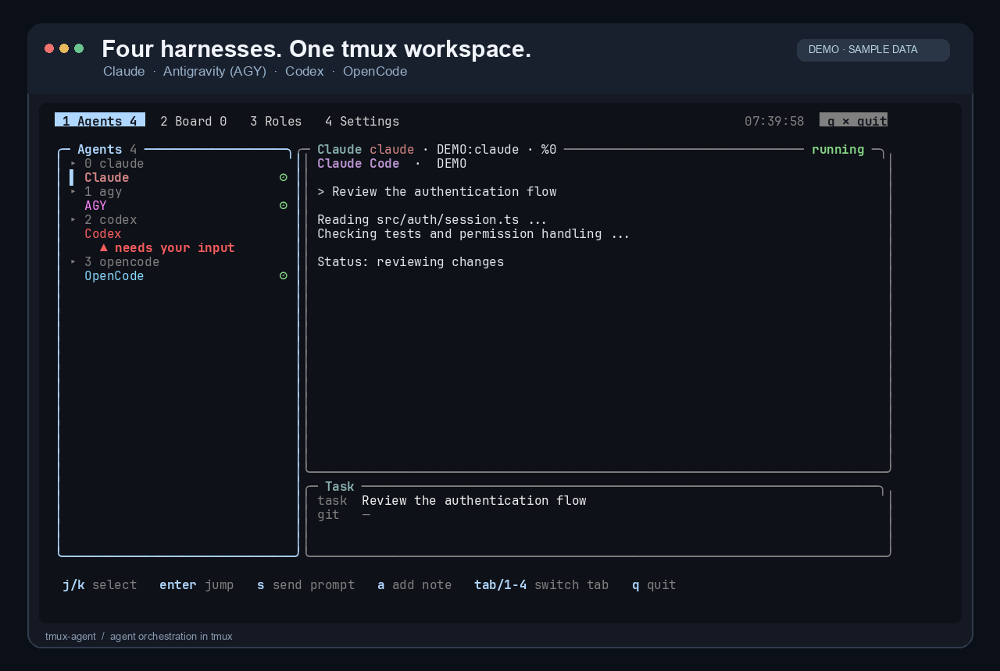

<h1 align="center">tmux-agent</h1>

<p align="center"><strong>Coordinate your AI coding agents without leaving tmux.</strong></p>

<p align="center">
  <a href="LICENSE"></a>
  <a href="go.mod"></a>
</p>

tmux-agent brings Claude Code, Antigravity (AGY), Codex, OpenCode, Pi, Gemini, Copilot, Amp and other coding agents into one workspace. See what each agent is doing, find the ones waiting for you, and coordinate work across panes and projects.

## Demo



*The demo uses simulated agent sessions and sample project data.*

[Install](#install) · [Get started](#get-started) · [Features](#features) · [Commands](#cli) · [Configuration](#configuration)

## One view for the whole team

**Watch the work.** A sidebar follows your tmux windows and shows each agent's status, harness color, elapsed time, and requests that need attention. Expand it into a dashboard to inspect the selected pane without losing your place.

**Coordinate across agents.** Send or queue prompts, share project context on a board, start workers with roles, and track a team against a task board. The CLI is available to you and to agents with the corresponding integration installed.

**Keep control.** Review approval requests in the sidebar, inspect worktree changes before merging, and use checkpoints to return to earlier work. Notifications and the optional mascot help surface events without replacing your decisions.

## Features

| | What you can do |
|---|---|
| **Sidebar and dashboard** | Track agents by window, inspect live panes, and jump to an agent that needs you. |
| **Harness support** | Integrate Claude Code, Codex, Pi and OpenCode; detect supported agents without hooks through screen scraping. |
| **Team workflow** | Share a project board, start agents with roles, queue prompts, and run multi-step plans. |
| **Worktrees and checkpoints** | Isolate changes, compare results, inspect diffs, merge work and restore snapshots. |
| **Customizable UI** | Choose a theme, colors, keybindings, mascot and optional language model through Settings. |

## Get started

After [installing](#install), open tmux and start a supported agent. The sidebar shows detected agents in your windows. Use the tmux prefix followed by **`e`** to toggle the sidebar and **`A`** to open the dashboard.

```sh
tmux-agent list                         # see your agents
tmux-agent ctx add "API contract: …"   # share a project note
tmux-agent new --name tester --role tester
tmux-agent send tester --wait "Run the tests and report failures"
```

See the [keybindings](#keys) and [CLI reference](#cli) for the full workflow.

## Install

```sh
curl -fsSL https://raw.githubusercontent.com/minhnhat97kg/tmux-agent/main/install.sh | bash
```

The script clones into `~/.local/share/tmux-agent` → builds → links
`~/.local/bin/tmux-agent` → adds one `run-shell` line to `~/.tmux.conf` (only
once) → loads it into the running tmux → runs `tmux-agent install` for every
harness it finds. Run it again to **update**.

Requirements: tmux ≥ 2.9, git, Go (the version in `go.mod`).

Options (environment variables): `TMUX_AGENT_DIR` (clone location),
`TMUX_AGENT_BIN_DIR` (where the binary is linked), `TMUX_AGENT_REF`
(branch/tag), `TMUX_AGENT_NO_TMUX=1` (don't touch tmux.conf),
`TMUX_AGENT_NO_HARNESS=1` (don't install hooks/skills).

<details>
<summary>Manual install</summary>

```sh
git clone <repo> ~/.local/share/tmux-agent && cd ~/.local/share/tmux-agent
make build && ln -s "$PWD/bin/tmux-agent" ~/.local/bin/tmux-agent
echo "run-shell '$PWD/assets/tmux-agent.tmux'" >> ~/.tmux.conf
tmux source ~/.tmux.conf
tmux-agent install
```
</details>

### Harness integration

```sh
tmux-agent install --list          # support matrix + which harnesses are on this machine
tmux-agent install                 # every harness found
tmux-agent install claude pi       # specific ones
tmux-agent install --dry-run       # show what would be written
tmux-agent uninstall <harness>     # remove exactly what install wrote
```

| Harness | Exact status | Agent learns the CLI from |
|---|---|---|
| claude | hooks → `~/.claude/settings.json` | skill |
| codex | hooks → `~/.codex/hooks.json` | skill |
| pi | extension → `~/.pi/agent/extensions/tmux-agent.ts` | skill |
| opencode | plugin → `~/.config/opencode/plugins/tmux-agent.js` | block in `AGENTS.md` |
| gemini · copilot · amp | screen detection (scraper) | block in its instructions file |

Hooks are **merged** into the config (nothing else is overwritten; the
original is kept as `*.tmux-agent.bak`); re-running doesn't duplicate them.
Agents without hooks (Cursor, Aider…) are still detected from the screen.

To let agents use the CLI (post to the board, start helpers) without asking
you each time, allow it in the harness — for Claude, in
`~/.claude/settings.json`: `"permissions": { "allow": ["Bash(tmux-agent:*)"] }`.

## Usage

### Keys

| Key | Where | Does |
|---|---|---|
| `prefix + e` / `E` | tmux | toggle the sidebar in this window / all windows |
| `prefix + A` | tmux | expand / collapse the sidebar into the dashboard (zoom, layout untouched) |
| `prefix + a` | tmux | quick action: go to the agent that needs you / send `@agent_done_prompt` to one that finished |
| `space` · click avatar | sidebar | same as `prefix + a` |
| `j` `k` · mouse | sidebar | move (wheel, click a row) |
| `enter` | sidebar | jump to the pane |
| `1` `2` `3` · `y` `n` | sidebar | answer the prompt of the selected waiting agent |
| `o` · click `o ⇱ expand` | sidebar | open the dashboard |
| `,` | sidebar / dashboard | settings: sidebar opens the popup, dashboard jumps to the Settings tab |
| `/` `r` `p` `v` `x` | sidebar | filter · repo filter · pin · select · delete worktree |
| `tab` | dashboard | cycle Agents → Board → Roles → Settings (`1`–`4` select a tab; the right panel shows the full note / role prompt / setting; in Roles: `n` start an agent with it, `e` edit it in `$VISUAL`/`$EDITOR` (a built-in is copied to your roles dir first), `a` new role, `d` delete yours; in Settings: `j/k` move, `enter`/`space` toggle or cycle forward, `h/l` (`←/→`) cycle back/forward, `e` edit a text/number, `r` reset) |
| `s` / `a` / `d` | dashboard | send a prompt / add a note / delete a note |
| `o` `q` `esc` | dashboard | collapse |

### CLI

| Command | Does |
|---|---|
| `tmux-agent new --name <name> [--role r] [--worktree] [--agent claude] [-- args]` | Start an agent in an `agents` window (at most `@agent_max_panes` per window). `--role`: a ready-made role; `--worktree`: its own worktree on branch `agent/<name>` |
| `tmux-agent roles [<name>]` | List roles, or print one's prompt (also `tab` → Roles in the dashboard; built-in: reviewer, tester, docs, planner; add/override with `~/.config/tmux-agent/roles/<name>.md`) |
| `tmux-agent answer <pane> <1\|2\|…\|y\|n\|?>` | Answer an agent's approval prompt (also right in the sidebar) |
| `tmux-agent diff <name> [--stat]` · `merge <name> [--discard]` · `discard <name>` | Review / merge / drop the changes of an agent running in a worktree |
| `tmux-agent fanout -n 3 [--role r] [--wait] "<prompt>"` · `compare <prefix>` | Best-of-N: the same task to N agents in N worktrees, compare, keep the best |
| `tmux-agent team [name[@role]...]` | Start your workers (default: config `team`, e.g. `"w1 w2 rev@reviewer"`) and hand each the task-board prompt; with `team_autostart on` every new tmux session does it |
| `tmux-agent plan run <file>` | Multi-step plan: one line per task, `name [@role] [after a,b]: prompt` |
| `tmux-agent save` · `restore [--dry-run]` | Save / bring back your agents after a restart (Claude resumes its session); auto-saved every 30s |
| `tmux-agent tokens` | Tokens used per Claude agent + total |
| `tmux-agent config [list\|get\|set\|reset\|path]` | Central configuration; no arguments = the settings screen (also `,` in the sidebar, or the Settings tab in the dashboard) |
| `tmux-agent list [--json]` | pane · name · agent · status · window · cwd |
| `tmux-agent name [<pane>] <name>` | Name an agent; the name works instead of a pane id everywhere |
| `tmux-agent send <pane> [--now] [--wait] [--timeout D] <prompt>` | Type a prompt + Enter. A busy agent (working, or waiting on you) gets it **queued** and delivered when idle; `--now` types right away |
| `tmux-agent ask [--role r] [--wait] "<task>"` | Give a task to an idle agent of this repo (with that role), or start a new one if nobody is free |
| `tmux-agent queue [pane]` · `queue clear <pane>` | Show / drop queued messages |
| `tmux-agent checkpoints <agent>` · `undo <agent> [n]` | Every turn starts with a snapshot of the repo; `undo` rolls the files (and the branch, if the agent committed) back to before the last turn — or n turns back. `undo <agent> --redo <ref>` undoes the undo |
| `tmux-agent wait <pane> [--until stopped\|idle\|waiting] [--timeout D]` | Wait for a status (exit 124 on timeout) |
| `tmux-agent read <pane> [-n 50]` | Last N lines of the screen |
| `tmux-agent events [--json]` | Stream status changes / tool calls (one event per line) |
| `tmux-agent next` | The avatar's quick action (most urgent agent: waiting → error → just finished) |
| `tmux-agent kill <pane…>` | Close agent panes (refuses non-agent panes) |
| `tmux-agent ctx [--global] [ls] \| add <text> \| rm <id> \| clear [--mine] \| scope` | Shared context |
| `tmux-agent reload` | After a rebuild: restart the sidebars + scraper |
| `tmux-agent install` / `uninstall` | Harness integration (see above) |

An orchestration example (agents can do this themselves through the skill):

```sh
tmux-agent name lead
tmux-agent ctx add "API contract: …"            # every agent of this repo can read it
tmux-agent new --name tester --role tester
tmux-agent send tester --wait --timeout 20m "Run the tests and fix failures"
tmux-agent read tester -n 80
tmux-agent kill tester
```

### Approvals, warnings, notifications

- **Approval inbox:** an agent waiting for approval shows its question and
  options right under it in the sidebar; put the cursor on it and press
  `1`/`2`/`3` (or `y`/`n`) to answer without jumping to its pane.
- **File conflicts:** two agents of the same project editing the same file
  within 10 minutes → a warning in the list and from the avatar, a note on the
  shared context, and a notification.
- **Stuck agents:** a `running` agent with no activity for
  `@agent_stuck_minutes` minutes (default 10) → a warning.
- **Undo a turn:** before each agent turn the repo's files are snapshotted
  (`@agent_checkpoints`, on by default; a throwaway index and refs under
  `refs/tmux-agent/` — your index, branch and files aren't touched).
  `tmux-agent undo <agent>` puts things back as they were before its last turn.
- **Phone:** `tmux-agent config set notify_url https://ntfy.sh/<topic>` (or a
  Telegram bot `sendMessage` URL) to get the notifications on your phone.

### Central configuration

`,` in the sidebar opens the settings popup; the dashboard's **Settings** tab
(`tab` → Settings, `4`, or `,`) has the same list, with the selected setting
and its keys in the right panel. `tmux-agent config` opens the standalone
screen. It covers avatar (character, LLM, language, lines…), sidebar, agents,
team, notifications, keys. Changes apply at once and are saved to
`~/.config/tmux-agent/config.conf` (tmux syntax, loaded by the plugin at
startup). From scripts: `tmux-agent config set <key> <value>` — short names
work (`avatar`, `width`, `notify_url`…).

### Shared context

Each **git repo** (by cwd) has its own board; `--global` is the board shared
by all. Add a note with `tmux-agent ctx add "…"` in the project's directory,
`a` in the dashboard (goes to the selected agent's project), or ask an agent
to post one. The sidebar shows the latest notes ("board · <project>") in the free space under the
list, only when the board has any; in the dashboard, `tab` → pick a note to read it in full.

### Task board & team

The shared context doubles as a task list, by convention (agents learn it
from the skill):

```
TODO @w1: write tests for internal/auth
DOING @w1: write tests for internal/auth
DONE @w1: write tests for internal/auth → 12 tests in auth_test.go, all pass
```

Workers pick up the TODOs with their name, turn each into DOING, then DONE
with a one-line result. Always put a name on a TODO — there is no atomic
claim, so two workers could grab an unnamed one. Agents in `--worktree`
checkouts are in another project: use `ctx --global` for the whole team then.

Set your team up once and every session can have it:

```sh
tmux-agent config set team "w1 w2"         # names, optionally name@role: "w1 rev@reviewer"
tmux-agent config set team_autostart on    # each new tmux session starts it (default off)
tmux-agent team                            # or start it by hand in this session
```

`team` starts the workers (`new --name …`) and sends each `team_prompt` —
by default "work the task board: do every TODO @<name>". Workers already
running (names are server-wide) are skipped; one stuck on a startup prompt
(folder trust) doesn't get the prompt — answer it, then send it yourself.

Then hand out work and collect the results:

```sh
tmux-agent ctx add "TODO @w1: write tests for internal/auth"
tmux-agent ctx add "TODO @w2: update the README install section"
tmux-agent send w1 "check the board"; tmux-agent send w2 "check the board"
tmux-agent wait w1; tmux-agent wait w2
tmux-agent ctx                             # read the DONE lines, then ctx rm them
```

Or let a lead agent do all of it: "split X into TODOs for w1 and w2 on the
task board, wait, and summarize the results".

### Statuses

| | Meaning |
|---|---|
| running | working |
| waiting | needs you (approval, a question, folder trust…) |
| background | the agent stopped but a background shell still runs |
| done | finished while you weren't looking at its pane — turns idle once you visit it |
| idle / error | idle / failed |

### Avatar

The top of the sidebar holds a small pixel character (drawn with braille:
28×16 pixels in 14 columns × 4 lines) that watches every agent and nudges you
like a friend:

> ▲ Hey, reviewer is done and everything passes — send it the commit prompt?

| Character (`@agent_avatar`) | |
|---|---|
| `slime` (default) | breathes asleep, bounces at work, jumps and squashes when happy, shakes when it needs you, melts when sad |
| `cat` | ear twitches, blinks, `^` eyes when happy, ears up when alarmed, down when sad |
| `sprout` | grows while working, blooms when done, waves its leaves when it needs you, wilts on errors |
| `ghost` | floats, rippling hem |
| `robot` | blinking antenna light, "talking" mouth while working |
| `off` | hidden |

**On kitty / Ghostty** the avatar is a real picture: the same characters as
colored pixel art (mood-colored body, outline, eyes), shown through kitty's
Unicode placeholders so it lives happily inside tmux (needs
`allow-passthrough on|all`, tmux ≥ 3.3). Use your own image or animated GIF —
for every mood, or per mood:

```tmux
set -g @agent_avatar_image ~/pets/cat.gif            # every mood
set -g @agent_avatar_image_alert ~/pets/cat-jump.gif # sleep | work | happy | alert | sad
set -g @agent_avatar_images auto                     # auto (kitty/Ghostty client) | on | off
set -g @agent_avatar_image_rows 12                   # picture height in lines (2 cols per line); default 4
```

**Its lines** are written by `claude -p --model haiku` (one short, friendly
sentence offering help — never a dump of the session), cached and shared by
every sidebar so one event costs one call; while it answers (a few seconds),
or with the LLM off, a built-in line in the same tone is shown. The default
language is English (`@agent_avatar_lang en`); set `vi` for Vietnamese. Panes
too short for the full avatar get a compact one.

**Quick action** (`space`, a click on the avatar, or `prefix + a` from
anywhere): a waiting or failed agent → jump to its pane (approvals are always
your call); a finished agent → send `@agent_done_prompt` if set, else jump to
it.

```tmux
set -g @agent_avatar sprout
set -g @agent_avatar_lang en                   # vi | en
set -g @agent_digest_llm "ollama run --nowordwrap --think=false qwen3:0.6b"   # writes the avatar's line on every agent event; prompt = last argument
set -g @agent_avatar_lines 6                   # text lines in the speech bubble (1–8, default 1)
set -g @agent_done_prompt "commit and summarize what you did"
set -g @agent_avatar_say_done "{name} is done!"      # your own line (overrides the LLM)
```

### Status line

```tmux
set -ga window-status-format         ' #{E:@agent_status_format}'
set -ga window-status-current-format ' #{E:@agent_status_format}'
set -ga status-right '#{E:@agent_session_status_format}'
```

## Configuration

Set options with `set -g …` before loading the plugin, or use `tmux-agent config`.

| Option | Default | |
|---|---|---|
| `@sidebar_width` | `15%` | sidebar width (columns or %) |
| `@sidebar_position` | `left` | `left` / `right` |
| `@sidebar_auto_create` | `on` | create the sidebar in new windows |
| `@sidebar_key` / `@sidebar_key_all` | `e` / `E` | toggle keys |
| `@agent_watch_key` | `A` | dashboard key |
| `@agent_action_key` | `a` | quick action key |
| `@agent_digest_llm` | `ollama run --nowordwrap --think=false qwen3:0.6b` | command writing the avatar's line on every agent event — who needs you, who works on what (prompt = last argument); a small local model is enough |
| `@agent_avatar` | `slime` | `slime` / `cat` / `sprout` / `ghost` / `robot` / `off` |
| `@agent_avatar_images` | `auto` | picture avatar on kitty/Ghostty: `auto` / `on` / `off` |
| `@agent_avatar_image` · `_<mood>` | — | your picture / GIF (all moods, or one) |
| `@agent_avatar_image_rows` | `4` | lines your picture takes (4–24, square: 2 columns per line); bigger = sharper |
| `@agent_avatar_lang` | `en` | `vi` / `en` |
| `@agent_avatar_lines` | `1` | text lines in the speech bubble (1–8) |
| `@agent_avatar_personality` | `cheerful, cute and encouraging` | how the avatar talks — pick a preset (tsundere, lazy office cat, sarcastic, pirate…) or describe your own |
| `@agent_avatar_llm` | `claude -p --model haiku` | command writing the dashboard's task summaries; `off` = none |
| `@agent_done_prompt` | — | prompt the quick action sends to a finished agent |
| `@agent_avatar_say_waiting` / `_done` / `_error` | | your own lines; `{name}`, `{action}` |
| `@agent_max_panes` | `4` | max agents per `agents` window |
| `@agent_team` | | workers for `tmux-agent team` (`name[@role] …`) |
| `@agent_team_autostart` | `off` | start the team in every new session |
| `@agent_team_prompt` | task board | sent to each worker, `{name}` = its name |
| `@agent-sidebar-default-agent` | `claude` | default agent for `new` |
| `@agent_scrape` | `on` | screen detection for agents without hooks |
| `@agent_checkpoints` | `on` | snapshot the repo before each agent turn (for `undo`) |
| `@agent_stuck_minutes` | `10` | warn when a running agent shows no activity this long |
| `@sidebar_notifications` | `on` | desktop notifications |
| `@agent_notify_url` | — | also push notifications here (ntfy topic or Telegram `sendMessage` URL) |
| `@agent_theme` | `dark` | `dark` / `light`; `@agent_color_<token>`, `@agent_icon_<token>` override single colors/icons |

## Development

```sh
make build && tmux-agent reload   # build + reload the running sidebars/scraper
make test
make update-frames                # re-capture the sidebar's golden frames (check them by eye first)
```

tmux ≥ 2.9 is required because the query layer uses `#{q:…}` to escape `|` in
user data; verified on tmux 3.7b.

## Origin

The architecture and part of the assets derive from
[hiroppy/tmux-agent-sidebar](https://github.com/hiroppy/tmux-agent-sidebar) —
see [NOTICE](./NOTICE). The orchestration ideas come from
[herdr](https://herdr.dev).

## Contributing

Contributions, bug reports and feature requests are welcome. Please open an [issue](https://github.com/minhnhat97kg/tmux-agent/issues) or a pull request.

## License

This project is licensed under the [MIT License](LICENSE). See [NOTICE](NOTICE) for attribution.

---

README structure adapted from [readme-md-generator](https://github.com/kefranabg/readme-md-generator).
